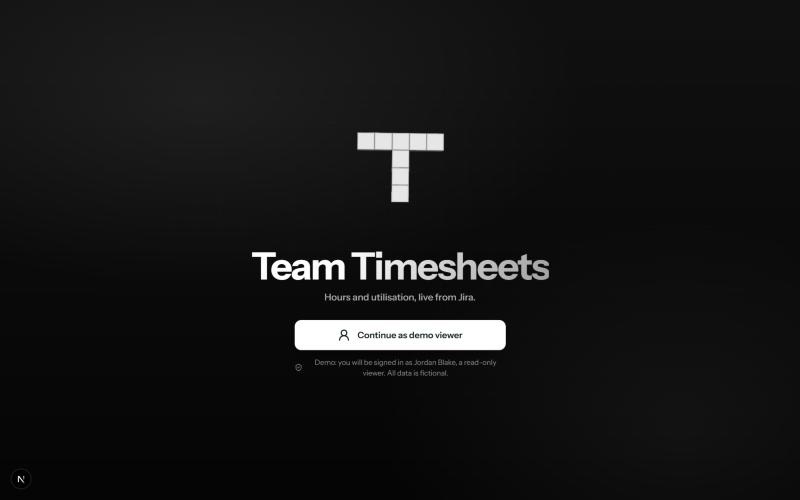
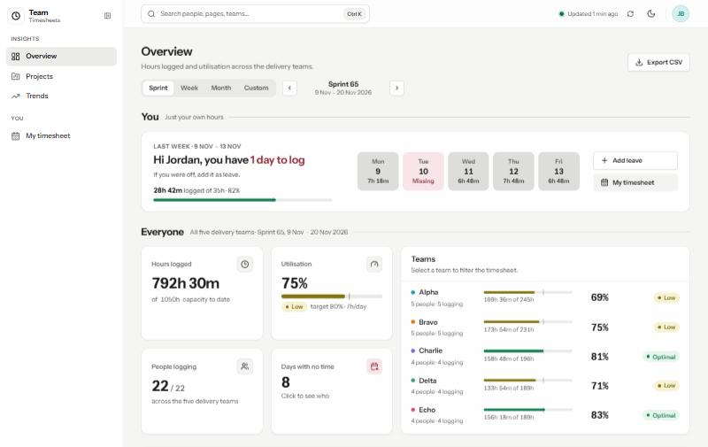
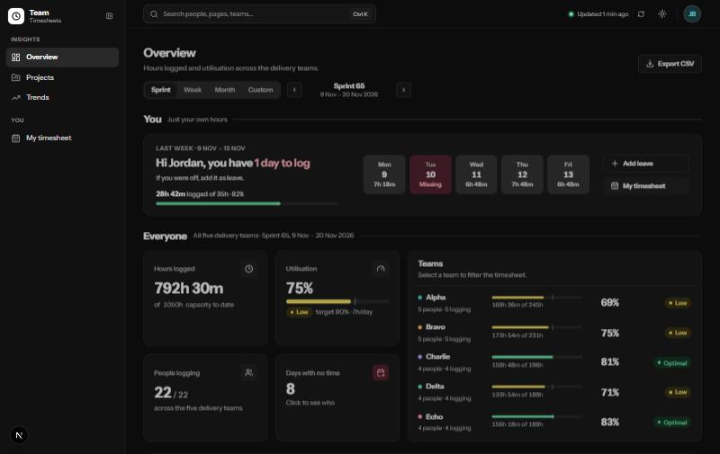
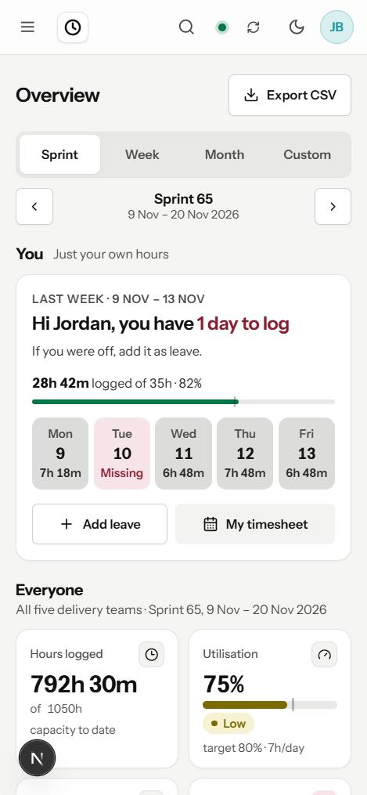

# Team Timesheets

A web app that turns Jira worklogs into a live team timesheet and utilisation dashboard: who logged what, per day, per team and per sprint, measured against capacity.

> Built during my project management internship at DxDy for the team's own use. This public copy contains **no company data**: every person, number, email and project is fictional, and there are no credentials in the repo. Sign-in on the demo is a button that signs you in as a made-up, read-only viewer.

| Sign in | Overview (light) | Overview (dark) | Phone |
|---|---|---|---|
|  |  |  |  |

**Live demo:** _add the Vercel link here once deployed_

**Stack:** Next.js 16 (App Router) · React 19 · TypeScript · Postgres (Neon) · NextAuth (Google sign-in) · Jira REST API · Vercel (hosting and a daily cron).

## What it does
- Pulls worklogs from Jira into Postgres (on open when the data is stale, with a manual refresh, and on a daily cron).
- **Overview:** hours per person per day, grouped by team, with utilisation = logged ÷ capacity (working days minus public holidays and leave) against an 80% target. Sprint, week, month and custom ranges.
- **Projects** (hours per project) and **Trends** (utilisation by sprint, per team).
- **My timesheet:** a personal calendar of last week's hours, flags days with nothing logged, and lets people add their own leave.
- Sidebar navigation, a Ctrl K command palette to jump to any person or page, CSV export.
- Role-based access: **viewer** (everyone on the company domain, read-only), **manager** (edit people, leave and holidays) and **admin** (settings, activity log, recycle bin). Pages and API routes check the role on every request.
- Audit log of every change, sign-in history, and a recycle bin for anything deleted.
- Light and dark themes, responsive phone layout, installable as a home-screen app.

## Run the demo locally
1. Create a Postgres database (a free [Neon](https://neon.tech) one works).
2. `cp .env.example .env.local`, set `DATABASE_URL` and keep `DEMO=1`.
3. `npm install`
4. `npm run db:demo` creates the tables, loads the fictional roster and about 20 weeks of fictional worklogs.
5. `npm run dev`, open http://localhost:3000 and press **Continue as demo viewer**.

With `DEMO=1` the refresh button tops up the fictional data to today, so the demo never looks stale.

## Run it for real
Leave `DEMO` unset and fill in the Jira, Google OAuth and `ADMIN_EMAILS` / `MANAGER_EMAILS` / `ALLOWED_DOMAIN` settings in `.env.example`. Run `npm run db:setup` (or `db:seed` for a starter roster), then deploy to Vercel with the same variables.

## Notes
- Database changes live in `db/migrations` and are applied once each by `scripts/migrate.mjs`; on Vercel the build runs it for the production site only.
- `npm run gen:sql` regenerates `lib/setup-sql.ts` and `lib/demo-sql.ts` from the SQL files after you change them.
- Roles are decided on every request from the environment variables, so removing someone takes effect immediately.
